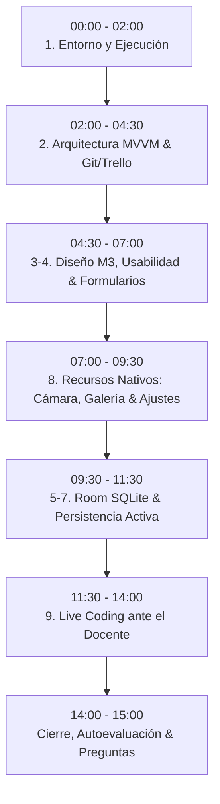

# 🏆 Guía Maestra de Defensa Técnica Individual (100% de Logro)
## Evaluación Parcial 3 — DSY1105: Desarrollo de Aplicaciones Móviles
### Proyecto: TeqGastos (TEQMED SpA)

---

## 📌 1. Ficha Técnica y Reglas de Oro

| Parámetro | Detalle |
| :--- | :--- |
| **Tiempo Asignado** | **15 minutos cronometrados** |
| **Ponderación** | **32%** de la nota final de la asignatura |
| **Modalidad** | **Individual y presencial** en laboratorio con Android Studio y emulador/físico |
| **Ponderación del Live Coding** | **72% del puntaje** depende de demostrar y modificar código en vivo |
| **Ponderación Conceptual** | **28% del puntaje** (Arquitectura, UI, Estado, Permisos) |
| **Prohibiciones estrictas** | **Sin uso de IA, sin apuntes ni diapositivas**. Solo código fuente en Android Studio. |

> [!CAUTION]
> **Regla de Cero Tolerancia:** Si la aplicación no compila o crashea al iniciar la defensa, la pauta instruye calificar todos los ítems subsiguientes con **puntaje cero (0)**. Verifica siempre que el proyecto compile con `./gradlew assembleDebug` antes de entrar.

---

## ⏱️ 2. Guion Cronometrado Minuto a Minuto (Los 9 Puntos Obligatorios)



---

### Minuto 00:00 – 02:00 | Punto 1: Configuración del Entorno
- **Acción:** Abre Android Studio con el proyecto `TeqGastos`. Presiona **Run (Shift + F10)** en el emulador (o teléfono físico).
- **Qué decir textualmente:**
  > *"Buenas tardes profesor/a. El entorno está configurado en Android Studio con Gradle 8.x, Java/JDK 17 y Android SDK Target 35 (mínimo SDK 26 para soportar Java Time API sin desugaring pesado). La app utiliza Jetpack Compose BOM 2024 para UI declarativa y Room Database con procesador KSP para persistencia local reactiva. Como se aprecia en el emulador, la aplicación compila y ejecuta limpiamente en el flujo de inicio."*

---

### Minuto 02:00 – 04:30 | Punto 2: Estructura del Proyecto, Arquitectura y Herramientas Colaborativas (IE 2.3.2)
- **Acción:** Abre el árbol de paquetes en el explorador de Android Studio (`app/src/main/java/com/example/teqgastos/`).
- **Qué decir textualmente:**
  > *"El proyecto sigue estrictamente el patrón arquitectónico **MVVM (Model-View-ViewModel)** y el principio de **Unidirectional Data Flow (UDF)**, organizado por capas de responsabilidad única:*
  > 1. *`data/local`: Base de datos SQLite encapsulada con **Room** (`AppDatabase`), DAOs (`GastoDao`, `RendicionDao`) y entidades inmutables.*
  > 2. *`data/repository`: `TeqGastosRepository` actúa como **fuente única de verdad**, abstrayendo la base de datos local y sincronización remota.*
  > 3. *`ui/viewmodel`: `GastoFormViewModel` y `TecnicoViewModel` gestionan el estado reactivo mediante `StateFlow`, sobreviviendo a cambios de configuración del ciclo de vida.*
  > 4. *`ui/screens` y `ui/components`: Vistas declarativas puras en Jetpack Compose que renderizan el estado y emiten eventos al ViewModel sin lógica de negocio acoplada.*
  >
  > *En cuanto a herramientas colaborativas, utilizamos **GitHub** con ramas por feature (`feature/room-persistence`, `feature/form-validation`) y **Trello/Kanban** para el seguimiento de historias de usuario y trazabilidad del trabajo en pareja."*

---

### Minuto 04:30 – 07:00 | Puntos 3, 4 y 6: Diseño M3, Usabilidad, Formularios y Animaciones (IE 2.1.1, IE 2.1.2, IE 2.2.2)
- **Acción 1:** En el emulador, haz clic en el botón flotante **"Nueva Rendición"** y luego entra a una rendición para tocar **"Registrar Gasto"**.
- **Acción 2:** Intenta presionar **"Guardar Gasto en Terreno" con todos los campos vacíos**.
- **Qué mostrar y decir:**
  > *"1. **Material Design 3 y Usabilidad:** Aplicamos el sistema tipográfico M3, espaciados consistentes y paleta cromática accesible (con acentos suaves Neumorphic y botones en Glassmorphism).*
  > *2. **Transiciones y Animaciones (Punto 6):** Al navegar entre pantallas (`AppNavHost`), implementamos transiciones animadas con `fadeIn() + slideIntoContainer()` que suavizan los cambios de pantalla, reduciendo la carga cognitiva según las heurísticas de Nielsen.*
  > *3. **Validación Integral de Formularios (IE 2.1.1):** Observe qué ocurre si presiono Guardar con campos en blanco: **todos los campos requeridos se iluminan en rojo al mismo tiempo** (`isError = true`), acompañados de `trailingIcon` con `Icons.Default.Error` y mensajes de soporte descriptivos (`supportingText`).*
  > *4. Al tipear datos válidos (por ejemplo el RUT chileno validado por Módulo 11 o un monto mayor a cero), el ícono cambia dinámicamente a un `Icons.Default.CheckCircle` en color verde de éxito.*
  > *5. Si el monto ingresado supera el tope máximo de la categoría ($40.000 en Almuerzo, por ejemplo), el sistema despliega reactivamente una alerta animada con `AnimatedVisibility` exigiendo una justificación de mínimo 10 caracteres."*

---

### Minuto 07:00 – 09:30 | Punto 8: Recursos Nativos (Cámara, Galería y Ajuste Visual) (IE 2.4.1, IE 2.4.2)
- **Acción 1:** En `RegistroGastoScreen`, muestra el bloque de comprobante de respaldo.
- **Acción 2:** Toca **"Cámara Simple"** (se solicita el permiso en runtime o se abre la cámara del emulador) y toma una foto de prueba.
- **Acción 3:** Toca **"Galería Fotos"** (demostrando `PickVisualMedia` nativo de Android).
- **Acción 4:** Una vez cargada la imagen, usa los chips de ajuste en vivo:
  - Toca **"Recortar (Crop)"** $\rightarrow$ cambia a **"Ajustar (Fit)"**.
  - Toca **"Borde: 14dp"** $\rightarrow$ cambia a **"Borde: 24dp"**.
  - Toca **"Zoom"** $\rightarrow$ se abre el diálogo modal ampliado.
- **Qué decir textualmente:**
  > *"1. **Permisos y Seguridad (IE 2.4.1):** El permiso `CAMERA` está declarado en el `AndroidManifest.xml`, pero implementamos la solicitud segura en tiempo de ejecución con `rememberLauncherForActivityResult(ActivityResultContracts.RequestPermission())` verificando `ContextCompat.checkSelfPermission` para evitar `SecurityException`.*
  > *2. **Doble Recurso Nativo:** Integramos tanto la **Cámara nativa** (`TakePicture` con `FileProvider`) como la **Galería del dispositivo** mediante el moderno Photo Picker de Android (`PickVisualMedia`), garantizando que la app funcione incluso si el emulador no tiene hardware de cámara configurado.*
  > *3. **Procesamiento en Segundo Plano:** La imagen capturada es optimizada automáticamente por `ImageCompressor` mediante `withContext(Dispatchers.IO)`, redimensionándola y comprimiéndola a JPEG calidad 80% para ahorrar memoria y almacenamiento en SQLite.*
  > *4. **Ajuste de Presentación en Tiempo Real (IE 2.4.2):** Como se observa en pantalla, disponemos de controles interactivos para alternar el encuadre entre `ContentScale.Crop` y `ContentScale.Fit`, ajustar el radio de curvatura de bordes (14dp vs 24dp), y abrir un visor modal para inspección detallada."*

---

### Minuto 09:30 – 11:30 | Puntos 5 y 7: Gestión de Estado y Persistencia Room SQLite (IE 2.2.2, IE 2.3.1)
- **Acción 1:** Guarda el gasto completado. Verás que vuelve inmediatamente a `DetalleRendicionScreen`.
- **Acción 2:** Escribe una palabra en la barra de búsqueda de gastos (ej. el nombre del proveedor o folio). Verás cómo la lista se filtra reactivamente.
- **Acción 3:** Toca el ícono de basurero en un gasto borrador para eliminarlo y muestra el diálogo de confirmación.
- **Acción 4:** Cierra la aplicación por completo (deslízala en apps recientes) y vuelve a abrirla. Los datos están intactos.
- **Qué decir textualmente:**
  > *"1. **Gestión de Estado (IE 2.2.2):** La UI observa los datos mediante `StateFlow` y flujos reactivos de Room (`Flow<List<GastoEntity>>`). Cuando se inserta o borra un gasto, el DAO emite una nueva lista por el pipeline asíncrono y Compose recombina únicamente los nodos afectados.*
  > *2. **Persistencia Activa (IE 2.3.1):** Las operaciones CRUD completas están implementadas en `GastoDao` y `RendicionDao` sobre SQLite:*
  >    - *`@Insert`: Guarda gastos y comisiones.*
  >    - *`@Query`: Recupera y filtra gastos reactivamente.*
  >    - *`@Update`: Permite editar un gasto existente.*
  >    - *`@Delete`: Elimina comprobantes descartados.*
  > *Al cerrar la app y reabrirla, comprobamos que los registros residen de manera durable en la base de datos relacional local `teqgastos_database`."*

---

### Minuto 11:30 – 14:00 | Punto 9: Demostración de Modificación en Tiempo Real (Live Coding)
El profesor elegirá una o dos modificaciones. Dirígete a la sección 3 de esta guía (recetario) y aplícala con calma.

---

### Minuto 14:00 – 15:00 | Cierre y Autoevaluación
- **Qué decir textualmente:**
  > *"Como autoevaluación, el proyecto cumple con los 8 indicadores de logro: arquitectura desacoplada MVVM, validación reactiva estricta con íconos visuales de error/éxito, recursos nativos de hardware con permisos seguros en runtime y persistencia local activa con Room SQLite. Todo el código respeta estándares de modularidad y legibilidad."*

---

## 💻 3. Recetario de Live Coding (Los 4 Desafíos Más Probables)

### Desafío 1: "Agrega una nueva validación o un nuevo campo al formulario de gasto" (IE 2.1.1 - 20%)

**Ejemplo solicitado:** Agregar un campo opcional/obligatorio *"Comentarios Adicionales"* con validación de mínimo 5 caracteres.

1. **Abrir `GastoFormViewModel.kt`**:
   - En `data class GastoFormState`, agregar:
     ```kotlin
     val comentario: String = "",
     val comentarioError: String? = null,
     ```
   - En `GastoFormViewModel`, agregar la función:
     ```kotlin
     fun onComentarioChanged(valor: String) {
         val err = if (valor.isNotBlank() && valor.trim().length < 5) "Mínimo 5 caracteres" else null
         _formState.value = _formState.value.copy(comentario = valor, comentarioError = err)
     }
     ```
2. **Abrir `RegistroGastoScreen.kt`**:
   - Dentro del `LazyColumn`, agregar un nuevo `item`:
     ```kotlin
     item {
         OutlinedTextField(
             value = state.comentario,
             onValueChange = { viewModel.onComentarioChanged(it) },
             label = { Text("Comentarios Adicionales") },
             placeholder = { Text("Detalle u observación de terreno...") },
             isError = state.comentarioError != null,
             trailingIcon = {
                 if (state.comentarioError != null) {
                     Icon(Icons.Default.Error, contentDescription = null, tint = MaterialTheme.colorScheme.error)
                 } else if (state.comentario.trim().length >= 5) {
                     Icon(Icons.Default.CheckCircle, contentDescription = null, tint = TeqSuccess)
                 }
             },
             supportingText = { state.comentarioError?.let { Text(it, color = MaterialTheme.colorScheme.error) } },
             modifier = Modifier.fillMaxWidth(),
             shape = RoundedCornerShape(12.dp)
         )
     }
     ```

---

### Desafío 2: "Crea o incorpora un nuevo componente visual/modular con animación" (IE 2.2.1 - 22%)

**Ejemplo solicitado:** Crear un Composable de badge de advertencia animado y colocarlo en pantalla.

1. **En `ui/components/` (o al final del archivo de la pantalla)**:
   ```kotlin
   @Composable
   fun BannerAlertaLiveCoding(
       mensaje: String,
       visible: Boolean,
       modifier: Modifier = Modifier
   ) {
       AnimatedVisibility(
           visible = visible,
           enter = fadeIn() + expandVertically(),
           exit = fadeOut() + shrinkVertically()
       ) {
           Surface(
               color = Color(0xFFFEF3C7),
               shape = RoundedCornerShape(10.dp),
               border = BorderStroke(1.dp, Color(0xFFF59E0B)),
               modifier = modifier.fillMaxWidth()
           ) {
               Row(
                   modifier = Modifier.padding(12.dp),
                   verticalAlignment = Alignment.CenterVertically
               ) {
                   Icon(Icons.Default.Warning, contentDescription = null, tint = Color(0xFFD97706))
                   Spacer(modifier = Modifier.width(8.dp))
                   Text(text = mensaje, style = MaterialTheme.typography.bodySmall, color = Color(0xFF92400E))
               }
           }
       }
   }
   ```
2. **Invocarlo en cualquier pantalla**:
   ```kotlin
   item {
       BannerAlertaLiveCoding(
           mensaje = "Atención: Rendición sujeta a auditoría contable.",
           visible = true
       )
   }
   ```

---

### Desafío 3: "Modifica o agrega una función de persistencia local en Room" (IE 2.3.1 - 18%)

**Ejemplo solicitado:** Agregar una consulta que cuente cuántos gastos hay en una rendición o que filtre gastos mayores a un monto específico.

1. **Abrir `GastoDao.kt`**:
   - Agregar la consulta SQL:
     ```kotlin
     @Query("SELECT COUNT(*) FROM gastos WHERE rendicionId = :rendicionId")
     suspend fun countGastosByRendicion(rendicionId: Long): Int
     ```
     *(O para filtrar por monto)*:
     ```kotlin
     @Query("SELECT * FROM gastos WHERE rendicionId = :rendicionId AND montoClp >= :montoMinimo")
     fun getGastosMayoresA(rendicionId: Long, montoMinimo: Double): Flow<List<GastoEntity>>
     ```
2. **Abrir `TeqGastosRepository.kt`**:
   - Exponer la función:
     ```kotlin
     suspend fun contarGastos(rendicionId: Long): Int = gastoDao.countGastosByRendicion(rendicionId)
     ```
3. **Llamarlo en el ViewModel o Screen**:
   - Demostrar que se ejecuta sin bloquear la interfaz gracias a `suspend` y `Dispatchers.IO`.

---

### Desafío 4: "Ajusta la presentación o lógica de carga del recurso nativo" (IE 2.4.2 - 12%)

**Ejemplo solicitado:** Cambiar la forma de la imagen o agregar un botón para rotar o cambiar a escala circular/espejada.

1. **Abrir `RegistroGastoScreen.kt`**:
   - Mostrar cómo la variable `contentScaleMode` y `cornerRadiusDp` controlan la UI.
   - Si pide forma circular:
     ```kotlin
     shape = CircleShape // en lugar de RoundedCornerShape
     ```
   - Si pide escala horizontal completa:
     ```kotlin
     contentScale = ContentScale.FillWidth
     ```
   - Si pide ajustar la elevación o el borde:
     ```kotlin
     border = BorderStroke(2.dp, TeqPrimary)
     ```

---

## 📋 4. Checklist Rápido Pre-Defensa

- [x] Ejecutar `./gradlew assembleDebug` $\rightarrow$ Resultado: **BUILD SUCCESSFUL**.
- [x] Ejecutar `./gradlew testDebugUnitTest` $\rightarrow$ Resultado: **BUILD SUCCESSFUL (todos los tests pasan)**.
- [x] Permiso `CAMERA` en runtime protegido con `RequestPermission()` (evita crash en vivo).
- [x] Selector de Galería `PickVisualMedia` activo como alternativa segura.
- [x] Formularios validados en vivo con `isError = true` y `trailingIcon` (Error / CheckCircle).
- [x] Transiciones animadas configuradas en `NavHost` (`enterTransition`, `popEnterTransition`).
- [x] Barra de búsqueda reactiva en `DetalleRendicionScreen` para demostrar consultas activas en Room.
- [x] Tablero Trello y repositorio GitHub disponibles para justificar `IE 2.3.2`.
