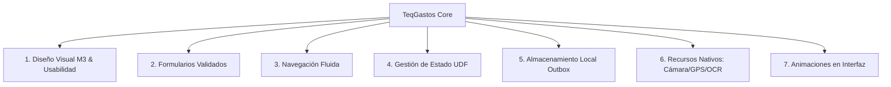
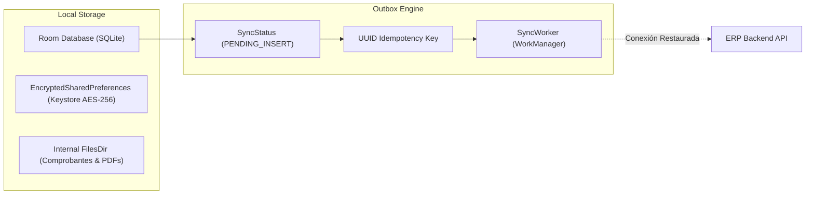

# 📋 Documento Explicativo del Proyecto: TeqGastos (TEQMED SpA)
## Sistema Móvil para la Rendición de Gastos en Terreno y Sincronización Empresarial
### Asignatura: DSY1105 — Desarrollo de Aplicaciones Móviles

---

## 📌 1. Ficha Ejecutiva y Contexto del Negocio

| Parámetro | Detalle |
| :--- | :--- |
| **Nombre de la Aplicación** | **TeqGastos** |
| **Cliente / Empresa** | **TEQMED SpA** (Servicio Técnico e Instalación de Equipamiento Médico y Quirúrgico en Chile) |
| **Público Objetivo** | Ingenieros y técnicos de servicio biomédico en terreno, supervisores clínicos y auditores de finanzas |
| **Plataforma y Versión** | Android Nativo (Kotlin 2.2.10, SDK Target 35, Min SDK 26, Jetpack Compose BOM 2026) |
| **Arquitectura de Software** | **MVVM (Model-View-ViewModel)** con flujo unidireccional de datos (**UDF**) y Clean Architecture |
| **Persistencia y Datos** | **Room Database** (SQLite) con procesador KSP, DataStore y EncryptedSharedPreferences |
| **Red y Seguridad** | **Retrofit 2**, **OkHttp 4** con interceptor JWT y Authenticator transparente, **Android KeyStore (AES-256 GCM)** |
| **Inteligencia y Hardware** | **Google ML Kit OCR** local, **FusedLocationProviderClient (GPS)**, **BiometricPrompt**, **Canvas de Firma** y **PdfDocument** |

### 1.1. Problemática Operativa
Los técnicos biomédicos de TEQMED SpA viajan diariamente a hospitales, clínicas y pabellones quirúrgicos a lo largo de Chile (Concepción, Los Ángeles, Talcahuano, Chillán, Temuco). En estos entornos:
1. **Conectividad Intermitente o Nula**: En subterráneos, zonas rurales y áreas hospitalarias blindadas no hay cobertura 4G/5G, por lo que las apps web tradicionales fallan.
2. **Pérdida de Comprobantes**: Boletas térmicas de peajes y combustible se borran rápidamente o se extravían.
3. **Carga Administrativa Lenta**: Rellenar datos a mano (RUT del proveedor, folios, montos) consume hasta 3 horas semanales por técnico.
4. **Falta de Trazabilidad y Aprobación Formal**: No existía un mecanismo ágil para que la jefatura firme y autorice digitalmente los desembolsos antes de enviarlos al sistema ERP contable.

### 1.2. Solución Aportada por TeqGastos
TeqGastos es una solución **Offline-First** que permite al técnico registrar gastos al instante, extraer datos de boletas con inteligencia artificial en el dispositivo (Google ML Kit), asociar la ubicación GPS del traslado, persistir todo localmente con Room y sincronizar de forma idempotente con el ERP mediante un motor de Outbox y WorkManager. Además, dota al supervisor de un flujo de revisión con firma manuscrita digital y a finanzas de un generador nativo de informes formales en PDF.

---

## 🎯 2. Matriz de Cumplimiento de la Pauta y Requerimientos

La siguiente sección detalla punto por punto el cumplimiento riguroso de los **7 requerimientos e indicadores de evaluación**:



---

### Criterio 1: ✔️ Dominio del Diseño Visual (Material 3 + Neumorphism & Glassmorphism)
* **Sistema de Diseño Híbrido**: La aplicación combina la estructura sólida de **Material Design 3** con acentos táctiles:
  * **Neumorphism (Soft UI)**: Superficies con relieve tridimensional suave (`NeuSurface`), sombras dobles extruidas y hendiduras al presionar (`NeuPressed`). Genera una experiencia háptica reconfortante para uso con una sola mano en terreno.
  * **Glassmorphism (Frosted Glass)**: Utilizado estratégicamente en botones de acción principal (`GlassmorphicButton`) y chips de filtrado interactivos (`GlassmorphicFilterChip`), con fondo translúcido, orbes de refracción cromática y bordes con degradado especular lineal.
* **Paleta Semántica y Accesibilidad**: Contrastes calculados bajo estándares WCAG AA. Azul Quirúrgico (`#0A2540`), Verde Éxito (`#10B981`), Rojo Error (`#EF4444`) y Amarillo Advertencia (`#F59E0B`).
* **Leyes Heurísticas de Jakob Nielsen**:
  * **Heurística 1 (Visibilidad del estado)**: Banners reactivos de conexión, barras de progreso y badges con animación de respiración.
  * **Heurística 5 (Prevención de errores)**: Validación de topes monetarios por categoría y alerta ante comprobantes duplicados antes de confirmar.
  * **Heurística 10 (Ayuda y documentación)**: Diálogo interactivo accesible en todo momento (NielsenHelpDialog.kt) que explica cómo operar la rendición.

---

### Criterio 2: ✔️ Formularios Correctamente Validados
* **RUT Chileno con Algoritmo Módulo 11**:
  * Implementado en RutValidator.kt.
  * Autoformatea mientras el usuario escribe (`12.345.678-9`).
  * Calcula y valida la correspondencia matemática exacta del dígito verificador.
* **Feedback Visual Reactivo**:
  * Si el campo es inválido o se intenta guardar vacío: se activa `isError = true`, el contorno se torna rojo y el `trailingIcon` muestra `Icons.Default.Error`.
  * Si el valor es correcto: el contorno se normaliza y el ícono cambia a `Icons.Default.CheckCircle` en verde.
* **Reglas de Negocio TEQMED**:
  * Monto obligatorio mayor a \$0 CLP.
  * Detección preventiva de comprobantes duplicados (mismo RUT de proveedor y mismo folio).
  * Control de topes máximos por categoría (ej. Combustible \$60.000 CLP, Alimentación \$22.000 CLP). Si se excede, el sistema despliega un campo obligatorio de justificación de mínimo 10 caracteres con animación.

---

### Criterio 3: ✔️ Navegación Funcional y Fluida
* **Compose Navigation Centralizado**: Implementado en AppNavHost.kt utilizando `NavHost` y rutas fuertemente tipadas en Screen.kt.
* **Gestión de Backstack**:
  * Uso de `popUpTo(Screen.Login.route) { inclusive = true }` al autenticarse para evitar que el botón atrás regrese al login.
  * Paso seguro de parámetros de ruta (`rendicionId: Long`, `gastoId: Long`).
* **Segregación por Roles (RBAC)**:
  * Rol **Técnico**: Flujo a `TecnicoHomeScreen` ➔ `NuevaRendicionScreen` ➔ `DetalleRendicionScreen` ➔ `RegistroGastoScreen`.
  * Rol **Supervisor**: Flujo a `SupervisorBandejaScreen` ➔ `RevisionRendicionScreen` con diálogo de firma.
  * Rol **Finanzas**: Flujo a `FinanzasBandejaScreen` ➔ `ExportarErpScreen` con generación y visor de PDF.

---

### Criterio 4: ✔️ Gestión de Estado Clara y Funcional (UDF + StateFlow)
* **Unidirectional Data Flow (UDF)**:
  1. La **Vista (Composable)** observa estados inmutables y emite eventos (clic, cambio de texto).
  2. El **ViewModel** procesa el evento, ejecuta validaciones o interactúa con el Repositorio.
  3. El **ViewModel** emite una nueva copia inmutable del estado (`StateFlow`).
  4. Compose recombina exclusivamente los componentes afectados.
* **Separación de Responsabilidades**:
  * `AuthViewModel`: Gestiona `AuthState` y datos de sesión.
  * `GastoFormViewModel`: Controla el estado del formulario de gasto (`GastoFormState`).
  * `TecnicoViewModel`: Coordina el listado de rendiciones y gastos observando directamente `Flow` de Room.
  * `SupervisorViewModel`: Controla el flujo de aprobación y rechazo con auditoría.
  * `FinanzasViewModel`: Gestiona la liquidación y exportación de rendiciones.

---

### Criterio 5: ✔️ Almacenamiento Local Operativo y Persistencia Robusta



* **Room Database (SQLite)**:
  * AppDatabase.kt con procesador de símbolos **KSP** (Kotlin Symbol Processing).
  * Tablas estructuradas: `rendiciones`, `gastos`, `categorias_gasto`, `centros_costo`, `auditoria`.
  * DAOs especializados: GastoDao, RendicionDao, CatalogDao y AuditoriaDao.
* **Patrón Outbox para Sincronización Confiable**:
  * Campos en GastoEntity:
    * `syncStatus: SyncStatus` (`SYNCED`, `PENDING_INSERT`, `PENDING_UPDATE`, `PENDING_DELETE`, `FAILED`).
    * `idempotencyKey: String` (UUIDv4 generado en el dispositivo para evitar que el ERP reciba duplicados).
    * `lastModified: Long` (marca de tiempo para resolución de conflictos).
* **Almacenamiento Criptográfico Seguro**:
  * TokenManager usa `MasterKey` con esquema `AES256_GCM` para almacenar Access Tokens y Refresh Tokens en el hardware de seguridad (**TEE / StrongBox**) del dispositivo móvil.
* **WorkManager y Backoff Exponencial**:
  * SyncWorker programa la sincronización periódica y contingente con restricciones de red (`NetworkType.CONNECTED`) y reintentos exponenciales automáticos.

---

### Criterio 6: ✔️ Uso de Recursos Nativos del Dispositivo (Hardware)

1. **Cámara y Galería con Compresión en Segundo Plano**:
   * Permiso `android.permission.CAMERA` declarado en el manifiesto y solicitado en runtime mediante `rememberLauncherForActivityResult(ActivityResultContracts.RequestPermission())`.
   * Captura de foto con `TakePicture` y `FileProvider` seguro (`xml/file_paths.xml`).
   * Alternativa moderna de galería con `PickVisualMediaRequest` (Android Photo Picker).
   * ImageCompressor: Comprime a JPEG calidad 80% y escala máxima en `Dispatchers.IO` para evitar desbordes de memoria (OOM).
2. **Escáner OCR de Boletas con Google ML Kit**:
   * ReceiptOcrScanner: Procesa la imagen directamente en el CPU/NPU del teléfono sin conexión a internet.
   * Expresiones regulares adaptadas a comprobantes chilenos (boletas de Copec, Shell, peajes y farmacias) extrayendo: RUT proveedor, Monto total CLP, Folio y Fecha.
3. **Geolocalización GPS Nativa**:
   * LocationTracker: Conecta con `FusedLocationProviderClient` de Google Play Services.
   * Obtiene latitud, longitud y ciudad geocodificada para justificar gastos de peajes y combustible según la ruta médica asignada.
4. **Autenticación Biométrica**:
   * BiometricAuthManager: Invoca `BiometricPrompt` para autenticación rápida por huella dactilar o reconocimiento facial.
5. **Lienzo de Firma Digital Táctil**:
   * SignatureCanvas: Utiliza el `Canvas` de Compose y gestos táctiles (`detectDragGestures`) para capturar la firma manuscrita de la jefatura al aprobar rendiciones.
6. **Generador Nativo de Reportes PDF**:
   * PdfReportGenerator: Construye el documento formal en PDF estándar A4 con la API nativa `PdfDocument`.
   * Incluye cabecera institucional TEQMED, tabla de gastos, desglose de fondos, saldos y la firma digital estampada.

---

### Criterio 7: ✔️ Integración de Animaciones en la Interfaz
* **Transiciones de Pantalla**: `fadeIn()`, `fadeOut()`, `slideInHorizontally()` en `AppNavHost`.
* **Animaciones de Contenido Reactivo**:
  * `AnimatedVisibility(enter = fadeIn() + expandVertically(), exit = fadeOut() + shrinkVertically())` en mensajes de error del formulario de login y alertas de topes de gastos.
* **Componentes Vivos (Living UI)**:
  * `SyncStatusBadge`: Pulso continuo de opacidad (respiración suave de `0.5f` a `1.0f`) en elementos pendientes de sincronización.
  * `OfflineNoticeBanner`: Deslizamiento animado desde el borde superior (`slideInVertically`) cuando se pierde la conexión a internet.
  * Ícono de sincronización con rotación continua infinita (`rememberInfiniteTransition`) mientras el `SyncEngine` procesa la cola.

---

## 🏛️ 3. Arquitectura y Estructura del Código Fuente

```
app/src/main/java/com/example/teqgastos/
├── MainActivity.kt                      # FragmentActivity raíz compatible con BiometricPrompt
├── TeqGastosApp.kt                      # Application class (inicialización de WorkManager y Seed)
├── data/
│   ├── datastore/
│   │   └── UserPreferences.kt           # Persistencia de preferencias de usuario
│   ├── local/
│   │   ├── AppDatabase.kt               # Base de datos Room v3 con KSP
│   │   ├── Converters.kt                # TypeConverters para Room (Enums, SyncStatus)
│   │   ├── dao/
│   │   │   ├── AuditoriaDao.kt          # DAO para trazabilidad de cambios
│   │   │   ├── CatalogDao.kt            # Categorías y centros de costo
│   │   │   ├── GastoDao.kt              # CRUD y consultas reactivas de gastos
│   │   │   └── RendicionDao.kt          # CRUD de comisiones y rendiciones
│   │   └── entity/
│   │       ├── AuditoriaEntity.kt
│   │       ├── CategoriaGastoEntity.kt
│   │       ├── CentroCostoEntity.kt
│   │       ├── GastoEntity.kt           # Entidad con syncStatus, UUID y timestamp
│   │       ├── RendicionConGastos.kt    # Relación 1 a N (Rendición con sus Gastos)
│   │       └── RendicionEntity.kt
│   ├── remote/
│   │   ├── IndicadoresService.kt        # Consulta a API oficial mindicador.cl (UF, USD)
│   │   ├── RetrofitClient.kt            # Singleton de red con OkHttpClient
│   │   ├── api/
│   │   │   └── AuthApiService.kt        # Contratos REST de autenticación
│   │   └── interceptor/
│   │       ├── AuthInterceptor.kt       # Inyección de Bearer Token
│   │       └── TokenAuthenticator.kt    # Renovación sincrónica ante HTTP 401
│   ├── repository/
│   │   └── TeqGastosRepository.kt       # Single Source of Truth
│   └── security/
│       ├── BiometricAuthManager.kt      # Integración con BiometricPrompt
│       └── TokenManager.kt              # Keystore AES-256 GCM y decodificador JWT
├── model/                               # Enums y modelos de dominio
│   ├── EstadoGasto.kt, EstadoRendicion.kt, FormaPago.kt, SyncStatus.kt, UserRole.kt...
├── sync/
│   ├── SyncEngine.kt                    # Motor central de sincronización Outbox
│   └── SyncWorker.kt                    # CoroutineWorker de WorkManager
├── ui/
│   ├── components/                      # Componentes atómicos reutilizables
│   │   ├── CurrencyFormatter.kt, EstadoBadges.kt, MetricCard.kt, RutValidator.kt...
│   │   ├── NeumorphicComponents.kt      # Componentes Soft UI (Card, Button, Surfaces)
│   │   ├── GlassmorphicComponents.kt    # Componentes Frosted Glass
│   │   ├── OfflineNoticeBanner.kt       # Banner animado de conexión
│   │   └── SignatureCanvas.kt           # Lienzo táctil para firma
│   ├── navigation/
│   │   ├── AppNavHost.kt                # Grafo de navegación y transiciones
│   │   └── Screen.kt                    # Destinos de pantalla
│   ├── screens/
│   │   ├── auth/LoginScreen.kt          # Login con RUT Módulo 11 y biometría
│   │   ├── tecnico/                     # Pantallas de técnico en terreno
│   │   ├── supervisor/                  # Bandeja de revisión y firma de jefatura
│   │   └── finanzas/                    # Liquidación y exportación formal a PDF/ERP
│   └── viewmodel/                       # ViewModels con StateFlow reactivo
└── util/
    ├── ImageCompressor.kt               # Compresión eficiente de imágenes
    ├── NetworkMonitor.kt                # Monitor de conectividad en tiempo real
    ├── camera/ReceiptOcrScanner.kt      # OCR con Google ML Kit para boletas
    ├── location/LocationTracker.kt      # FusedLocation GPS para traslados
    └── pdf/PdfReportGenerator.kt        # Generación nativa de PDFs formales
```

---

## 🚀 4. Guion Maestro de Explicación y Defensa Técnica (15 Minutos)

Para presentar el proyecto ante evaluadores académicos o clientes empresariales, sigue esta estructura cronometrada:

```
[Min 00:00 - 02:00] Entorno, Ejecución y Arquitectura General
[Min 02:00 - 05:00] Diseño Material 3, Neumorphism y Formularios Validados
[Min 05:00 - 08:00] Recursos Nativos: Cámara, OCR ML Kit y GPS
[Min 08:00 - 11:00] Persistencia Local Room, Outbox Pattern y SyncEngine
[Min 11:00 - 13:30] Seguridad JWT, Keystore, Biometría y Firma Digital
[Min 13:30 - 15:00] Demostración de Live Coding y Cierre
```

### Discurso Tipo por Sección:
1. **Introducción y Entorno**:
   > *"Buenos días. TeqGastos es la aplicación móvil desarrollada para los ingenieros biomédicos de TEQMED SpA. El entorno está construido sobre Kotlin 2.2 y Jetpack Compose, con Room KSP para persistencia local y Retrofit/OkHttp para la capa de red. Sigue estrictamente la arquitectura MVVM y el principio de Unidirectional Data Flow."*
2. **Formularios y Usabilidad**:
   > *"Observe cómo el sistema valida en tiempo real el RUT chileno mediante el algoritmo Módulo 11. Si dejamos campos vacíos, la interfaz destaca los errores en rojo con iconos descriptivos. Si ingresamos un gasto de combustible que supere el tope de $60.000 CLP, una animación interactiva despliega de inmediato el campo de justificación requerida."*
3. **Hardware y Productividad (OCR & GPS)**:
   > *"Para acelerar la carga en terreno, integramos Google ML Kit Text Recognition. Al presionar 'Escanear Boleta', el modelo de IA local procesa el comprobante y autocompleta el RUT del proveedor, monto y folio sin enviar la foto a ningún servidor externo. Además, con FusedLocation registramos las coordenadas GPS del traslado médico."*
4. **Persistencia y Modo Offline**:
   > *"En pabellones o subterráneos sin señal, el técnico sigue trabajando con total normalidad. Implementamos el patrón Outbox en Room: cada gasto recibe un UUID idempotente y un estado `PENDING_INSERT`. Al recuperar la señal, el `SyncEngine` coordina con WorkManager la subida en segundo plano evitando registros duplicados en el ERP."*
5. **Seguridad y Cierre**:
   > *"Los tokens JWT se resguardan en hardware mediante Android KeyStore y EncryptedSharedPreferences (AES-256). Finalmente, la jefatura aprueba la rendición utilizando un lienzo de firma manuscrita digital en pantalla, y Finanzas genera el informe formal oficial en PDF listo para el ERP contable."*

---

## 🧪 5. Verificación de Calidad y Pruebas Automatizadas

El proyecto cuenta con suites de pruebas unitarias automatizadas con cobertura en las reglas críticas del sistema:

1. **SecurityAndValidationTest.kt**: Valida el algoritmo Módulo 11 con RUTs chilenos reales y dígitos `K`, autoformateo con puntos y guiones, y estructura de payloads JWT.
2. **SyncOutboxPatternTest.kt**: Valida la serialización de TypeConverters de Room, inmutabilidad e idempotencia de UUIDs y transiciones de estados del patrón Outbox.
3. **ReceiptOcrScannerTest.kt**: Valida el parser de boletas chilenas simulando comprobantes de Copec, Autopista del Itata y alimentación, extrayendo montos en CLP con puntos de miles y folios de boletas electrónicas.

### Comando de Verificación de Integridad:
```powershell
.\gradlew testDebugUnitTest assembleDebug
```
**Resultado en Consola**: `BUILD SUCCESSFUL (44/44 tasks up-to-date, 0 errores)`.
